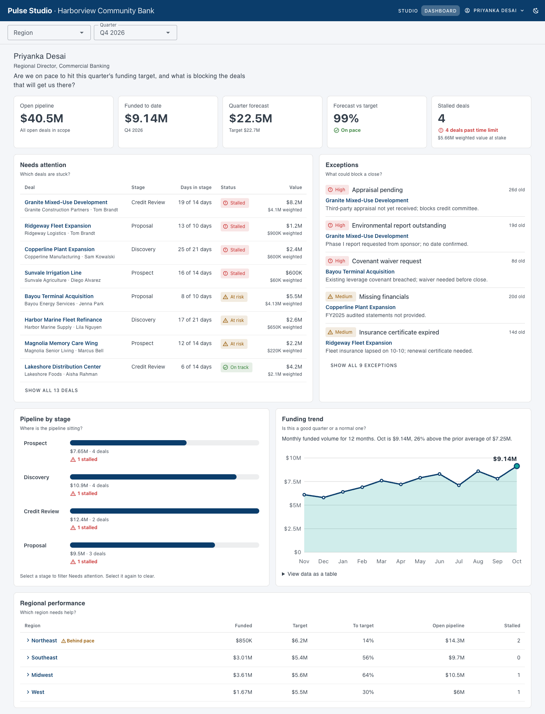
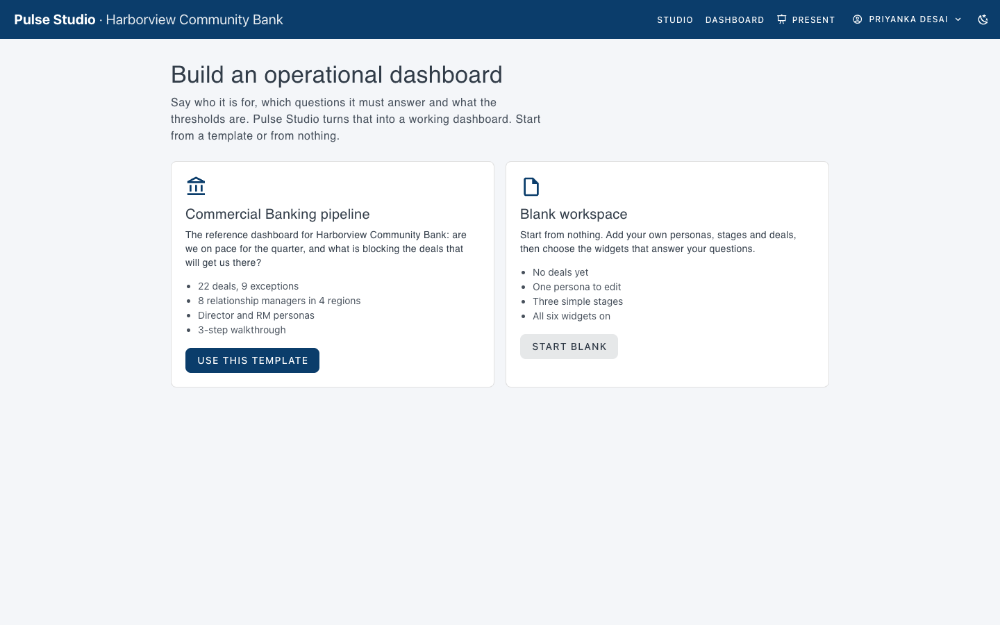
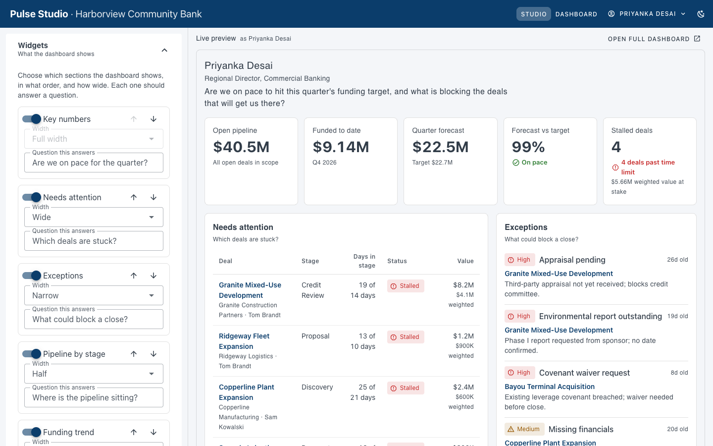
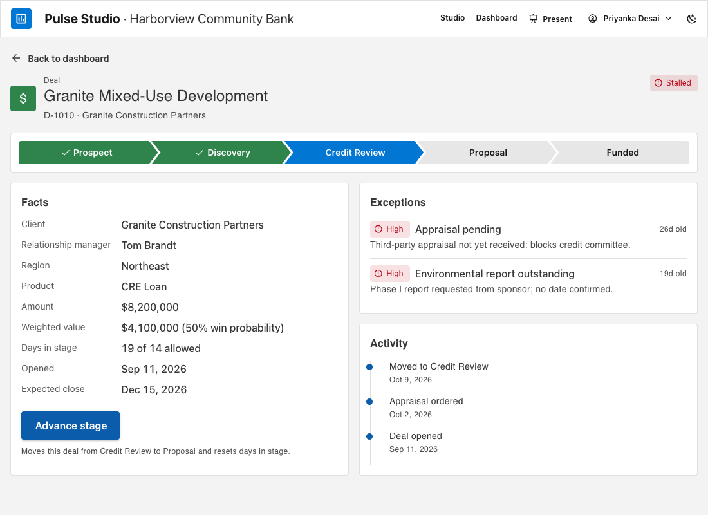
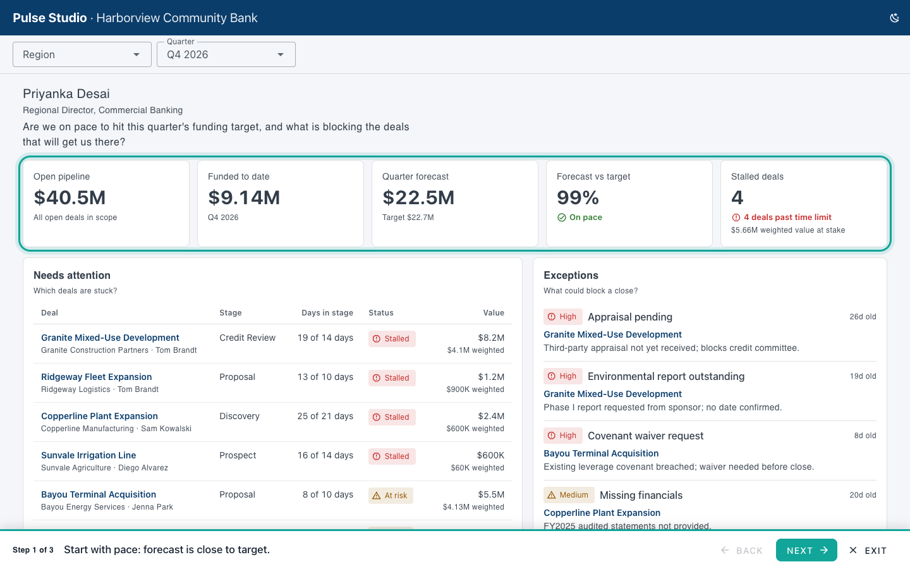
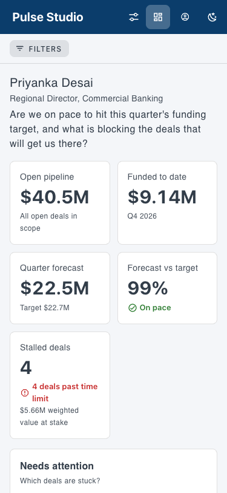
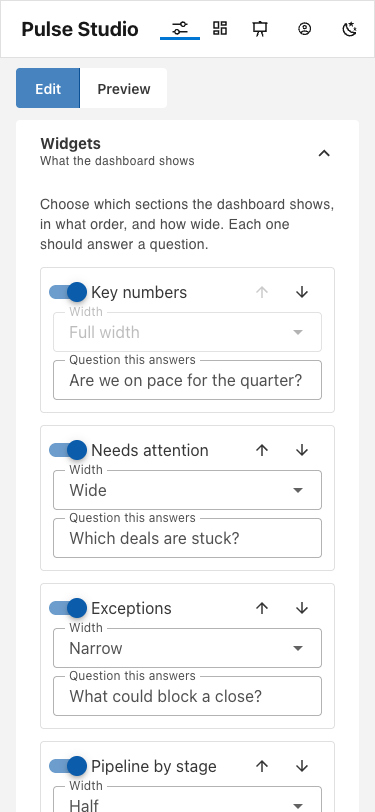
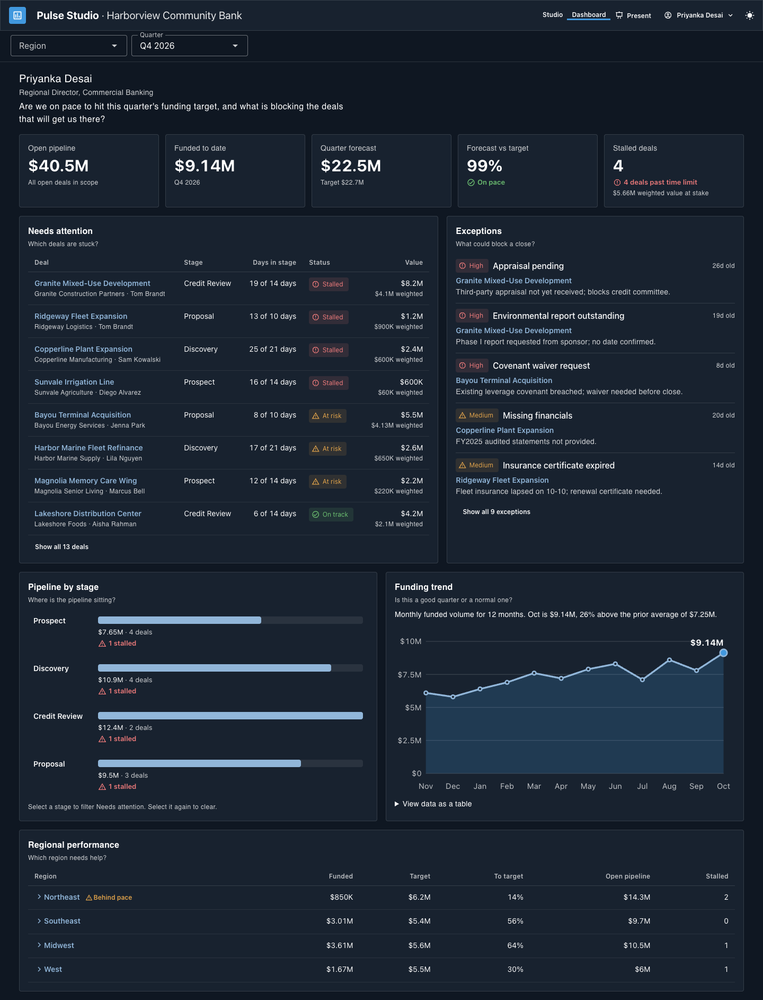

# Pulse Studio

A no-code builder for operational dashboards. An analyst says who the dashboard is for, which questions it must answer, and what data and thresholds it uses. Pulse Studio turns that into a working dashboard.

The reference build is a **commercial banking pipeline dashboard** for Harborview Community Bank: *are we on pace to hit this quarter's funding target, and what is blocking the deals that will get us there?*

**Live site:** https://demo-builder-xi.vercel.app/ · **Repo:** https://github.com/DaveCX-Slalom/demo-builder

> Training case study P301. All names, companies and numbers are invented. No real client or employer information is used.



## For reviewers

### Try it in three minutes

1. **Open the site.** The Start screen offers the Commercial Banking template or a blank workspace. Choose **Commercial Banking**.
2. **Read it as the director (`/dashboard`).** In the first screen you can see $40.5M open pipeline, $9.14M funded, a 99% forecast against target, and **4 stalled deals**. Needs attention sits under the KPIs, with problems before charts.
3. **Act on a deal.** Open *Granite Mixed-Use Development* (the largest stalled deal, $8.2M), then press **Advance stage**. Go back and the stalled count is 3. Use **View as** in the header to become Tom Brandt, the relationship manager, who sees only his own deals.
4. **Build it (`/studio`).** Change the brand colour, turn a widget off, drag a stage's days allowed down, or edit a deal's amount. The live preview beside the panels changes at once, and the full dashboard follows with no publish step.
5. **Present it.** Add a few steps in the Walkthrough panel, then press **Present** in the header. Arrow keys move, Esc exits.

Everything survives a reload. **Share and reset** in Studio exports and imports the whole workspace as JSON and restores the sample.

### What was built

| Phase | Scope | Status |
|---|---|---|
| 1. Dashboard from config | Config-driven dashboard, filters, deal detail, advance stage, persona switch, responsive, empty states | Built (required) |
| 2. Studio | Audience, brand, stages and thresholds, widgets, data editor, import and export, live preview | Built (required) |
| 3. Start and Present | Start screen with templates, walkthrough builder, Present mode | Built (optional) |
| 4. AI-assisted setup | Generate a first configuration from a description | Design only, as the BRIEF specifies |

All 18 user stories (US-1 to US-18), their acceptance criteria, and all functional requirements except the P3 print summary (FR-14) are met. The full table, with what was checked and how, is in **[docs/COVERAGE.md](docs/COVERAGE.md)**.

### Where each review area is covered

| Review area | What to look for | Where |
|---|---|---|
| Does it work? | Site live; core flows end to end; build matches the BRIEF | https://demo-builder-xi.vercel.app/ and the tour above. Acceptance results in [COVERAGE](docs/COVERAGE.md). Empty states, bad input, corrupt storage and 360 to 1920 px are covered too |
| Is the repo set up right? | AI scaffolding, README and LICENSE in the root, sensible structure, real history | [CLAUDE.md](CLAUDE.md), [.github/copilot-instructions.md](.github/copilot-instructions.md), [BRIEF](BRIEF.md), [PRD](docs/PRD.md), [SDD](docs/SDD.md) and [docs/context/](docs/context/) (progress, decisions and glossary, updated after each step). [LICENSE](LICENSE) is MIT. `git log` shows one descriptive commit per phase |
| Does it look right and show thinking? | Design fits the industry and user; the BRIEF reads like a plan | BRIEF section 5 (design decisions) and section 11 (tokens), matching what is built. The design is built for a regional director in commercial banking, who sees problems before charts |

### Decisions worth knowing

- **The dashboard is configuration, not code.** `DashboardCanvas` renders whatever `config.widgets` lists, through a widget registry. Adding a widget is one registry entry plus one component. The Studio preview and the full dashboard are the same component.
- **Nothing computed is stored.** Every KPI, status and rollup is derived from raw data by pure functions in `src/lib/derive.ts`, so any edit flows everywhere. The forecast is funded to date plus probability-weighted open deals expected to close this quarter.
- **One shared store.** Studio and Dashboard read the same `useWorkspace` store, so there is no publish step. No Pinia, no chart library, no test runner, as the BRIEF asks.
- **Status is never colour alone.** Every status has an icon, a label and a colour. Teal and amber from the first palette failed 4.5:1 text contrast, so the palette was adjusted rather than the rule bent.
- **Layout follows the widget, not the window.** Container queries mean the narrow Studio preview reflows correctly at any screen size.
- **Look and feel.** Visually inspired by the Salesforce Lightning Design System: a light global header, flat bordered cards, 4px radius and a chevron Path for deal stages. It uses no Salesforce logo, name or assets.
- **Invalid input never reaches the dashboard.** Studio fields keep a local draft and show the rule message, and a deal row saves only when valid.

More in [docs/context/decisions.md](docs/context/decisions.md).

### Deviations and limits, stated plainly

- **No password protection.** The BRIEF and SDD planned a password-protected Vercel site, and the case study instructions recommend one. The owner chose to keep it public, since every name and number is invented. The site stores data only in the visitor's browser, with no backend and no sign-in.
- **Not built:** the print-friendly summary (FR-14, priority P3), AI-assisted setup (Phase 4, design only), and the BRIEF nice-to-haves (a second template, saved views, undo for stage changes).
- **Keyboard testing is automated.** A scripted keyboard-only run passes (open a deal, advance it, open Studio panels, visible focus on every stop). A human keyboard-only pass has not been done.
- **The test scripts are not in the repo,** because the project rules exclude a test runner. The method and totals are in [docs/COVERAGE.md](docs/COVERAGE.md).

## Three ways in

**Start (`/`):** choose the Commercial Banking template or a blank workspace.



**Build (analyst, `/studio`):** settings panels on the left, live preview on the right. Every change shows up in the preview at once.



**Read (director or relationship manager, `/dashboard`):** read the KPI strip, see what needs attention, open a deal, advance it, and watch the dashboard update.



## What you can configure in Studio

| Panel | What it changes |
|---|---|
| Widgets | Turn sections on or off, reorder them, set width, edit the question each answers |
| Audience | Personas: name, role, scope (all or own deals), focus line, questions |
| Brand | Organization and product name, logo, primary and accent colours (with contrast warnings) |
| Stages and thresholds | Stage names, order, days allowed, win chance, and when a deal counts as at risk |
| Data | Edit, add and remove deals; invalid values are blocked inline |
| Walkthrough | A scripted tour for Present mode: screen, caption and highlight for each step |
| Share and reset | Export or import the whole workspace as JSON; reset to the sample |

**Present mode** runs the walkthrough full screen: it hides Studio, shows a bar with the caption and Back/Next (arrow keys work, Esc exits), opens each step's screen and highlights the widget being discussed.



## Run it

```bash
npm install
npm run dev       # http://localhost:5173
npm run build     # type-check + production build into dist/
npm run preview   # serve the production build
```

State lives in the browser (`localStorage`). There is no backend and no sign-in.

## Stack

Vue 3 (`<script setup>`), Vite, TypeScript, Vue Router, Vuetify 3. Charts are small SVG and CSS components, with no chart library. State is a single composable, with no Pinia.

## Project docs

- [BRIEF](BRIEF.md): design intent and scope
- [PRD](docs/PRD.md): requirements and acceptance criteria
- [SDD](docs/SDD.md): software design
- [Coverage](docs/COVERAGE.md): every requirement and how it was checked
- [Context](docs/context/): progress, decisions, glossary

## Quality

Checked in Chrome against the production build, locally and on the live site: 73 acceptance checks (one per criterion) with no failures, no horizontal scroll from 360 to 1920 px, light and dark themes, and an automated WCAG 2.1 AA scan with no violations. First load is about 200 KB and interactive in under a second.

| Phone dashboard | Phone Studio | Dark mode |
|---|---|---|
|  |  |  |

## Deploying

Vercel builds with `npm run build` and serves `dist/`. [vercel.json](vercel.json) rewrites every path to `index.html` so deep links such as `/deals/D-1010` work.
